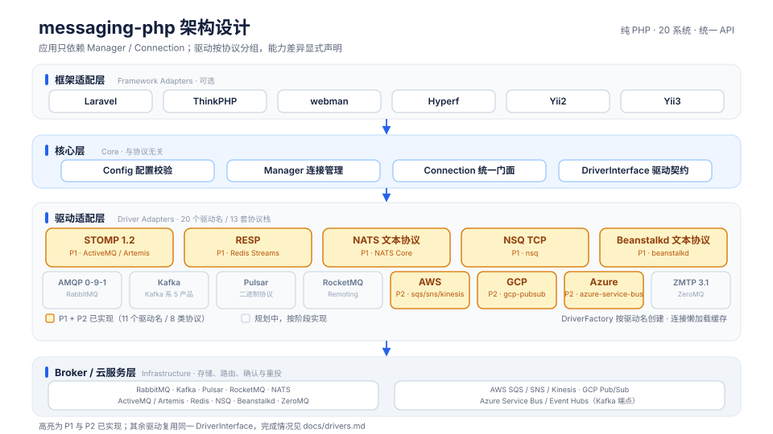
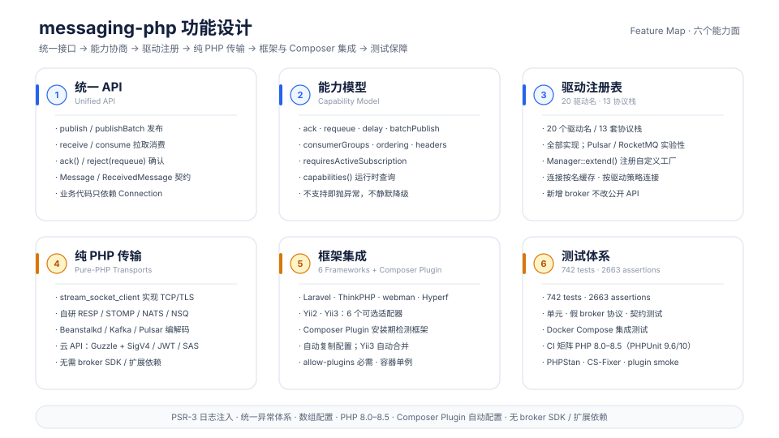
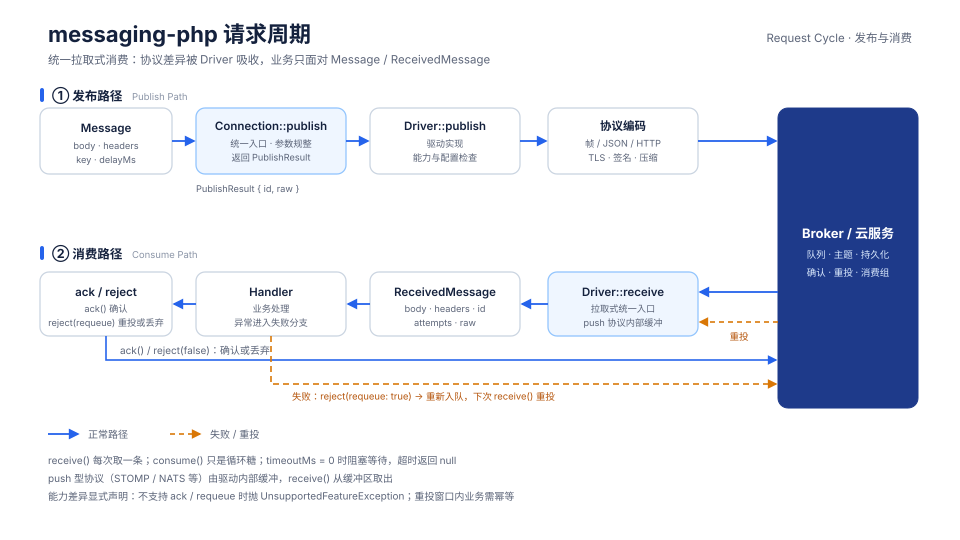
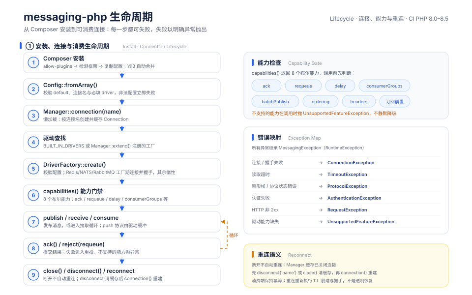

# messaging-php

[English](README_EN.md) | 中文

纯 PHP 实现的统一消息队列 / 事件流客户端：一套 `publish / receive / ack` API 覆盖 20 种系统，纯 PHP、无 broker SDK、无扩展依赖。

> RabbitMQ、Kafka、RocketMQ、Pulsar、ActiveMQ、ActiveMQ Artemis、NATS、Redpanda、AutoMQ、Redis Streams、AWS SQS、AWS SNS、AWS Kinesis、Google Cloud Pub/Sub、Azure Service Bus、Azure Event Hubs、ZeroMQ、NSQ、Beanstalkd、Confluent Platform

TCP 协议由 PHP 标准库实现，HTTP 云服务通过 Guzzle 直连；不依赖 rdkafka / ext-zmq / ext-redis 等 broker SDK 或扩展，`composer require` 后即可使用。

当前进度：**P1–P5 全部完成**，20 个驱动名全部实现——ActiveMQ、ActiveMQ Artemis、Redis Streams、NATS Core、NSQ、Beanstalkd、AWS SQS / SNS / Kinesis、Google Cloud Pub/Sub、Azure Service Bus、RabbitMQ、ZeroMQ、Kafka、Redpanda、AutoMQ、Confluent Platform、Azure Event Hubs、Pulsar、RocketMQ。完成情况与能力差异以 [驱动支持矩阵](docs/drivers.md) 为准。

项目站点：[https://package.erik.xyz/messaging](https://package.erik.xyz/messaging)

## 项目说明

20 个产品名收敛为 **13 套协议栈**：Kafka、Redpanda、AutoMQ、Confluent、Azure Event Hubs 共用 Kafka 协议；ActiveMQ 与 Artemis 共用 STOMP 驱动，只通过预设区分端口、requeue 与延迟语义；其余系统各自对应一套协议实现。切换 broker 通常只需改 `driver` 与连接配置，业务代码不变。

分层保持小而清晰：`Manager → Connection → DriverInterface`。`Manager` 负责配置与连接缓存，`Connection` 暴露 `publish / publishBatch / receive / consume / capabilities / close`，协议帧、握手、认证与错误映射全部收在 `src/Driver` 下按协议划分的目录内。驱动工厂在创建连接时校验必填配置；连接与握手由各驱动按需建立（Redis、NATS 在工厂阶段即连接，其余驱动首次操作时惰性连接）。配置错误在 `connection()` 阶段就失败，而不是等到第一次发布。

消费模型统一为**拉取式** `receive()`：拉取型协议直接读取，push 型协议（如 STOMP、NATS）在驱动内部缓冲后由 `receive()` 取出；`consume()` 只是 `while` 循环糖。超时返回 `null`，`timeoutMs = 0` 表示阻塞等待。

**能力显式声明，不做静默降级。** 每个驱动通过 `Capabilities` 声明 ack、requeue、delay、consumer group、批量发布、顺序、headers、订阅前置等能力；调用不支持的能力直接抛 `UnsupportedFeatureException`。同时，本库不承诺 exactly-once，投递语义由 broker 与驱动共同决定：

- **NATS Core**：至多一次，无 ack / requeue；消息只投递给发布时已存在的订阅，必须先订阅再发布。
- **Redis Streams**：`XACK` 确认、消费者组消费；未确认消息留在 PEL，需要 `XAUTOCLAIM` / `XCLAIM` 恢复，不支持同步 re-enqueue。
- **ActiveMQ Classic**：`reject(true)` 通过“重新 SEND + ACK 原投递”实现，两步之间断线会重复投递。
- **Artemis**：STOMP NACK 等同 ACK 丢弃（ARTEMIS-1983），不支持 requeue；只能通过断开消费者触发重投。
- **NSQ**：channel 必须先存在；驱动在首次 `receive()` 时惰性订阅，先发布后订阅的消息会丢失。
- **Beanstalkd**：内存队列，不支持 headers / key / 批量发布；超过 TTR 未确认会重投。

完整的逐驱动限制与恢复策略见 [docs/drivers.md](docs/drivers.md)。

## 项目宠物


小递是一台圆滚滚的浅蓝白色机器人信使：深色屏幕上亮着青色像素眼睛，头顶立着蓝色纸飞机天线，胸口有信封投递口和三盏代表 P1/P2/P3 的状态灯，脖子上围着 PHP 紫围巾。它把消息从一端送到另一端，就像 messaging-php 用一套 `publish / receive / ack` 把业务代码接到 20 种消息系统、13 套协议栈和 6 个框架适配器上。

小递的十二种表情（源文件在 [docs/pet-expressions](docs/pet-expressions/)）：

| 表情 | | | |
|:---:|:---:|:---:|:---:|
|  微笑 |  欢乐 |  哭泣 |  沮丧 |
|  惊恐 |  生气 |  撒娇 |  卖萌 |
|  讨好 |  敲打 |  捂脸 |  吐舌 |

## 特性

- **一套 API 覆盖 20 系统**：`publish`、`publishBatch`、`receive`、`consume`、`ack`、`reject`。
- **纯 PHP 传输**：TCP 用 `stream_socket_client`，TLS 与 gzip 基于标准 openssl / zlib（TLS 随驱动逐步开放）；自研 RESP、STOMP 1.2、NATS、NSQ、Beanstalkd 编解码，云服务驱动通过 Guzzle 加 SigV4 / JWT / SAS 签名。
- **能力模型**：`capabilities()` 运行时查询；不支持的能力抛异常，绝不静默忽略。
- **统一消息对象**：`Message` 支持 JSON、headers、key、delayMs；`ReceivedMessage` 提供 id、key、attempts、raw 与 ack/reject。
- **多连接管理**：`default` + `connections` 数组配置（每个连接必填 `driver`），连接懒加载并按名缓存；`Manager::extend()` 可注册自定义驱动工厂。
- **框架适配**：Laravel、ThinkPHP、webman、Hyperf、Yii2、Yii3，均为可选集成，不引入框架依赖。
- **可测试**：单元测试、假 broker 协议测试、共享契约测试、Docker Compose 集成测试四层。
- **统一异常**：连接、超时、协议、认证、HTTP 请求、能力缺失各有明确异常类型，全部继承 `MessagingException`。

## 安装

要求 **PHP >= 8.0**，标准扩展 `openssl`（TLS）与 `zlib`（gzip）即可。

```bash
composer config allow-plugins.erikwang2013/messaging-php true
composer require erikwang2013/messaging-php
```

- 不需要安装 rdkafka、ext-zmq、ext-redis，也不需要任何 broker 官方 SDK。
- 运行时依赖只有 Guzzle 与 PSR-3 日志接口，均由 Composer 自动安装。
- 框架适配器内置于同一包，按需使用；不使用任何框架时可直接裸用 PHP。

### 框架配置自动复制

本包同时是 Composer Plugin。Composer 2.2+ 需要先允许插件执行（上面的 `allow-plugins` 命令）；安装或更新时会检测项目里已安装的框架，并按各框架惯例复制默认配置：

| 框架 | 自动复制到 |
|---|---|
| Laravel | `config/messaging.php` |
| ThinkPHP | `config/messaging.php` |
| webman | `config/plugin/erikwang2013/messaging-php/{app,messaging,bootstrap}.php` |
| Hyperf | `config/autoload/messaging.php` |
| Yii2 | `config/messaging.php` |
| Yii3 | 无需复制：`yiisoft/config` 在运行时自动合并包内配置 |

已存在的目标文件不会被覆盖；如需自定义，直接修改复制后的文件。未允许插件时 Composer 会跳过本插件，安装仍会成功，此时可用各框架文档里的手动发布命令替代。

## 快速开始

### Redis Streams：发布、消费、确认

```php
<?php

use Erikwang2013\Messaging\Contract\Message;
use Erikwang2013\Messaging\Contract\ReceiveOptions;
use Erikwang2013\Messaging\Manager;

$mq = new Manager([
    'default' => 'redis',
    'connections' => [
        'redis' => [
            'driver' => 'redis',
            'host' => '127.0.0.1',
            'port' => 6379,
            'group' => 'orders',
            'consumer' => 'worker-1',
        ],
    ],
]);

$connection = $mq->connection();

$result = $connection->publish('orders', Message::json(['id' => 1], ['trace' => 'abc']));
echo $result->id; // Redis Stream ID

while ($message = $connection->receive('orders', new ReceiveOptions(timeoutMs: 5000))) {
    try {
        // 业务处理
        $message->ack(); // XACK
    } catch (Throwable $e) {
        // 不 ACK：消息留在 PEL，由 XAUTOCLAIM / XCLAIM 恢复
        error_log($e->getMessage());
    }
}
```

目的地（`publish` / `receive` 的第一个参数）即 Redis Stream 的 key。首次接收会自动创建消费者组，并从 `0` 开始消费，因此会读到此前积压的消息。

`consume()` 只是循环糖；处理成功后仍需自行 `ack()`：

```php
use Erikwang2013\Messaging\Contract\ConsumeOptions;

$connection->consume('orders', function ($message): void {
    // 业务处理
    $message->ack();
}, new ConsumeOptions(timeoutMs: 5000, maxMessages: 100));
```

### NATS Core：先订阅，再发布

Core NATS 只把消息投递给发布时已存在的订阅，跨连接消费时尤其要注意顺序：消费端先调用一次 `receive()` 建立订阅，生产端再发布；否则消息直接丢失（至多一次，无持久化）。

```php
// 假设 connections 中已配置 nats 连接
$nats = $mq->connection('nats');

$nats->receive('orders.created', new ReceiveOptions(timeoutMs: 1)); // 先建立订阅
$nats->publish('orders.created', new Message('hello'));

$message = $nats->receive('orders.created', new ReceiveOptions(timeoutMs: 1000));
```

NATS Core 的 `ack()` / `reject()` 均抛 `UnsupportedFeatureException`；需要持久化与确认语义时应使用 JetStream（当前未实现）。

## 框架集成

框架适配器随主包提供，不额外安装 Composer 包；只有使用对应框架时才需要该框架本身。配置内容（`default` + `connections`）与 `new Manager([...])` 一致，放置位置与注册方式随框架不同：

```php
// 放置路径随框架而定，见各框架文档
return [
    'default' => 'default',
    'connections' => [
        'default' => [
            'driver' => 'redis',
            'host' => '127.0.0.1',
            'port' => 6379,
            'group' => 'orders',
        ],
    ],
];
```

| 框架 | 注册方式 | 使用方式 | 详细文档 |
|---|---|---|---|
| Laravel | `MessagingServiceProvider` + `Messaging` 门面 | 容器注入 `Manager`，或使用门面 | [docs/frameworks/laravel.md](docs/frameworks/laravel.md) |
| ThinkPHP | `MessagingService` 服务类 | 容器注入 `Manager` 或 `app('messaging')` | [docs/frameworks/thinkphp.md](docs/frameworks/thinkphp.md) |
| webman | 插件 bootstrap（每个 worker 启动时执行） | `Messaging::connection()` / `Messaging::instance()` | [docs/frameworks/webman.md](docs/frameworks/webman.md) |
| Hyperf | `ConfigProvider` 自动发现 + `ManagerFactory` | 容器注入 `Manager`；`vendor:publish` 发布配置 | [docs/frameworks/hyperf.md](docs/frameworks/hyperf.md) |
| Yii2 | `MessagingComponent` 应用组件 | `Yii::$app->messaging->connection()` | [docs/frameworks/yii2.md](docs/frameworks/yii2.md) |
| Yii3 | `yiisoft/config`（`config/di.php` + `params.php`） | 容器注入 `Manager` | [docs/frameworks/yii3.md](docs/frameworks/yii3.md) |

## 驱动支持矩阵

20 个产品名由 13 套协议栈承载。完整矩阵、能力差异与阶段状态见 [docs/drivers.md](docs/drivers.md)。

| 阶段 | 驱动名 | 覆盖系统 | 状态 |
|---|---|---|---|
| P1 | `beanstalkd` | Beanstalkd | 已实现 |
| P1 | `redis` | Redis Streams | 已实现 |
| P1 | `nsq` | NSQ | 已实现 |
| P1 | `activemq`、`artemis` | ActiveMQ Classic、ActiveMQ Artemis | 已实现 |
| P1 | `nats` | NATS Core | 已实现（JetStream 未实现） |
| P2 | `sqs` | AWS SQS | 已实现 |
| P2 | `sns` | AWS SNS | 已实现（仅发布） |
| P2 | `kinesis` | AWS Kinesis | 已实现（简化 checkpoint） |
| P2 | `gcp-pubsub` | Google Cloud Pub/Sub | 已实现 |
| P2 | `azure-service-bus` | Azure Service Bus | 已实现 |
| P3 | `rabbitmq` | RabbitMQ | 已实现（默认交换机） |
| P3 | `zeromq` | ZeroMQ | 已实现（PUB/SUB、PUSH/PULL） |
| P4 | `kafka`、`redpanda`、`automq`、`confluent`、`eventhubs` | Kafka 系 5 个产品 | 已实现（无 SASL） |
| P5 | `pulsar` | Apache Pulsar | 已实现（实验；未跑真实 broker） |
| P5 | `rocketmq` | Apache RocketMQ | 已实现（实验；未跑真实 broker） |

P1–P5 驱动能力速查（`capabilities()` 的实际声明）：

| 驱动 | ack | requeue | delay | consumer group | 关键限制 |
|---|---|---|---|---|---|
| `activemq` | ✓ | ✓ | ✓ | ✗ | requeue 为重发 + ACK，可能重复 |
| `artemis` | ✓ | ✗ | ✓ | ✗ | STOMP NACK 等同丢弃；需先订阅 |
| `redis` | ✓ | ✗ | ✗ | ✓ | 未确认消息留在 PEL，需 XAUTOCLAIM 恢复 |
| `nats` | ✗ | ✗ | ✗ | 配置 `queue_group` 时 ✓ | Core 为至多一次，先订阅再发布 |
| `nsq` | ✓ | ✓ | ✗ | ✗ | channel 必须先存在；发布无 id |
| `beanstalkd` | ✓ | ✓ | ✓ | ✗ | 不支持 headers / key / 批量 |
| `sqs` | ✓ | ✓ | ✓ | ✗ | FIFO 逐条 delay 不支持；长轮询 |
| `sns` | ✗ | ✗ | ✗ | — | 仅 publish |
| `kinesis` | ✗（checkpoint） | ✗ | ✗ | 分片消费 | 内存 checkpoint + 可选回调 |
| `gcp-pubsub` | ✓ | ✓ | ✗ | ✓ | 单条 REST pull；attempts 恒为 1 |
| `azure-service-bus` | ✓ | ✓ | ✓ | ✗ | peek-lock；实体需预先存在 |
| `rabbitmq` | ✓ | ✓ | ✗ | ✗ | 默认交换机；无 publisher confirm |
| `zeromq` | ✗ | ✗ | ✗ | ✗ | PUB/SUB、PUSH/PULL；无持久化/确认 |
| `kafka` 系 | ✓（提交 offset） | ✓（seek 回退） | ✗ | ✓ | 仅 PLAINTEXT/TLS、gzip；无 SASL |
| `pulsar` | ✓ | ✓（negative ack） | ✓ | ✓ | 实验；无 batching/压缩/schema |
| `rocketmq` | ✓ | ✓（重试队列） | ✓（延迟等级） | ✓ | 实验；4.x remoting |

13 套协议栈已全部实现并覆盖 20 个驱动名。

逐驱动文档：[Beanstalkd](docs/drivers/beanstalkd.md) · [Redis Streams](docs/drivers/redis-streams.md) · [NSQ](docs/drivers/nsq.md) · [ActiveMQ](docs/drivers/activemq.md) · [Artemis](docs/drivers/artemis.md) · [NATS](docs/drivers/nats.md) · [SQS](docs/drivers/sqs.md) · [SNS](docs/drivers/sns.md) · [Kinesis](docs/drivers/kinesis.md) · [GCP Pub/Sub](docs/drivers/gcp-pubsub.md) · [Azure Service Bus](docs/drivers/azure-service-bus.md) · [RabbitMQ](docs/drivers/rabbitmq.md) · [ZeroMQ](docs/drivers/zeromq.md) · [Kafka](docs/drivers/kafka.md) · [Pulsar](docs/drivers/pulsar.md) · [RocketMQ](docs/drivers/rocketmq.md)

> P1 驱动目前均为明文 TCP，TLS 配置随驱动逐步开放；P2 云服务驱动将使用 HTTPS。

## 架构设计



自上而下四层：框架适配层只做容器绑定与配置发布；核心层 `Manager / Config / Connection` 与协议无关；驱动适配层按协议分组，20 个驱动名共享 13 套协议实现，Manager 按驱动名选择工厂、创建后的连接按名缓存；最下层是自建 broker 与云服务。图中全部 20 个驱动名均已实现并高亮。所有驱动实现同一个 `DriverInterface`，新增 broker 不需要改公开 API。

## 功能设计



六个能力面围绕同一个契约展开：API 只暴露消息与连接概念，能力模型把 broker 差异显式化，驱动注册表负责按名装配，纯 PHP 传输层吸收协议细节，框架集成与测试体系保证可用性。

## 请求周期



发布路径：`Message` 经 `Connection::publish` 进入驱动，完成协议编码后写入 broker，返回 `PublishResult`。消费路径：`receive()` 从 broker 拉取并由驱动还原为 `ReceivedMessage`，业务处理成功后 `ack()`；失败时 `reject(requeue: true)` 重新入队，由下一次 `receive()` 重投；`reject(false)` 确认并丢弃。不支持 ack / requeue 的驱动会在能力检查阶段抛异常。

## 生命周期



连接从配置数组开始：`Config::fromArray()` 校验默认连接与必填 `driver`，`Manager::connection()` 懒加载并按名缓存，驱动工厂完成配置校验，并按驱动策略建立连接与握手。连接就绪后先看 `capabilities()`，再进入 publish / receive / consume 循环；`ack()` 或 `reject()` 提交结果，`close()` 释放连接。断开不会自动重连，捕获异常后需重新 `connection()`；重连会重新执行工厂创建与握手，业务侧应保持幂等。

## 目录结构

```
messaging-php/
├── src/
│   ├── Manager.php                 # 多连接管理、驱动注册表
│   ├── Connection.php              # publish / receive / consume / capabilities
│   ├── Config/                     # Config · ConnectionConfig
│   ├── Contract/                   # DriverInterface · Message · ReceivedMessage · Capabilities 等
│   ├── Driver/
│   │   ├── Beanstalkd/             # 文本协议
│   │   ├── Nats/                   # NATS Core 文本协议
│   │   ├── Nsq/                    # NSQ TCP 协议
│   │   ├── Redis/                  # Redis Streams + RESP 编解码
│   │   └── Stomp/                  # STOMP 1.2 + ActiveMQ / Artemis 预设
│   ├── Exception/                  # MessagingException 与 6 个子类
│   ├── Integration/                # 框架适配器
│   │   ├── Laravel/                # ServiceProvider + Facade
│   │   ├── ThinkPHP/               # Service
│   │   ├── Webman/                 # 插件 bootstrap + 静态入口
│   │   ├── Hyperf/                 # ConfigProvider + ManagerFactory
│   │   └── Yii2/                   # MessagingComponent + 配置
│   └── Support/                    # Socket 等底层支撑
├── config/                         # Laravel / ThinkPHP 配置 · webman 插件 · Yii3 DI
├── tests/
│   ├── Unit/                       # 配置、编解码、驱动单元测试
│   ├── Protocol/                   # stream_socket_server 假 broker 协议测试
│   ├── Contract/                   # DriverContractTestCase 共享契约基类
│   └── Integration/                # 真实 broker 容器集成测试
├── docs/
│   ├── drivers.md                  # 20 系统支持矩阵与能力差异
│   ├── drivers/                    # 单驱动配置、限制与示例
│   ├── frameworks/                 # 六套框架集成文档
│   └── images/                     # 架构、功能、请求周期、生命周期 SVG
├── examples/                       # 驱动示例（逐步补充）
├── docker-compose.yml              # 按 profile 启停各 broker
├── phpunit.xml
├── composer.json
└── README.md
```

## 测试与开发

```bash
composer install
composer test          # tests/Unit + tests/Protocol，无需外部服务
composer phpstan       # 静态分析
composer cs            # 代码风格检查
```

集成测试连接真实 broker，按 profile 启动容器后运行：

```bash
docker compose --profile redis up -d
composer test-integration -- --filter RedisStreams
```

可用 profile：`redis`、`beanstalkd`、`nsq`、`activemq`、`artemis`、`nats`。连接不上 broker 时相关集成测试会自动 skip，不会阻塞本地开发。CI 在 PHP 8.0 上做语法与运行时冒烟检查，在 PHP 8.1–8.5 上跑单元与协议测试。

## 许可证

MIT，见 [LICENSE](LICENSE)。
