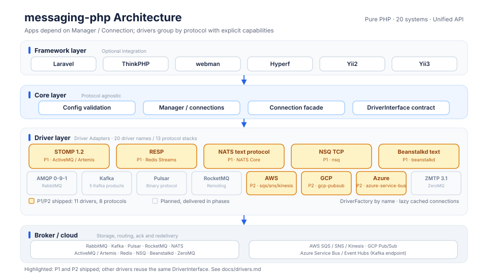
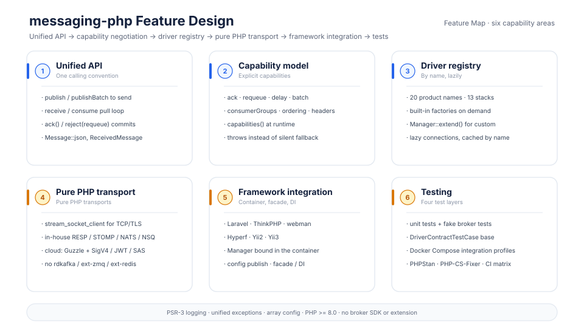
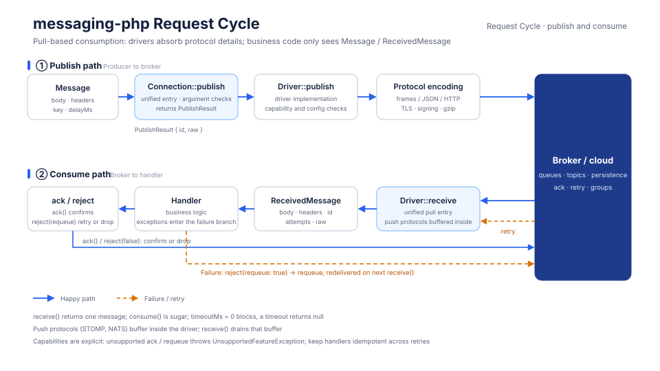
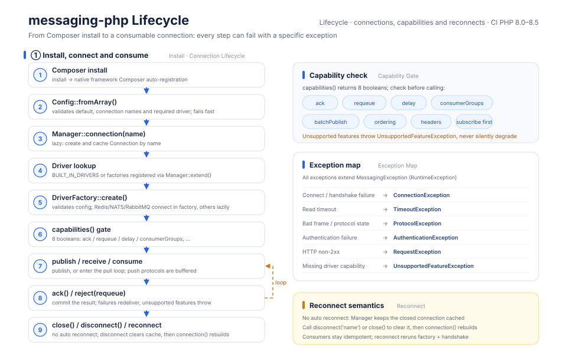

# messaging-php

[中文](README.md) | English

A unified message queue and event streaming client written in pure PHP: one `publish / receive / ack` API covers 20 systems, with no broker SDKs and no extension dependencies.

> RabbitMQ, Kafka, RocketMQ, Pulsar, ActiveMQ, ActiveMQ Artemis, NATS, Redpanda, AutoMQ, Redis Streams, AWS SQS, AWS SNS, AWS Kinesis, Google Cloud Pub/Sub, Azure Service Bus, Azure Event Hubs, ZeroMQ, NSQ, Beanstalkd, Confluent Platform

TCP protocols are implemented with the PHP standard library, and HTTP cloud services connect directly through Guzzle. No rdkafka, ext-zmq, ext-redis or other broker SDK or extension is required — it works right after `composer require`.

**Current status (v1.8.1): all P1–P5 phases are complete**, covering all 20/20 driver names — ActiveMQ, ActiveMQ Artemis, Redis Streams, NATS Core, NSQ, Beanstalkd, AWS SQS / SNS / Kinesis, Google Cloud Pub/Sub, Azure Service Bus, RabbitMQ, ZeroMQ, Kafka, Redpanda, AutoMQ, Confluent Platform, Azure Event Hubs, Pulsar and RocketMQ. See the [driver support matrix](docs/drivers.md) for status and capability differences.

Project site: [https://package.erik.xyz/messaging](https://package.erik.xyz/messaging)

## About

Twenty product names collapse into **13 protocol stacks**: Kafka, Redpanda, AutoMQ, Confluent and Azure Event Hubs share the Kafka protocol; ActiveMQ and Artemis share the STOMP driver, distinguished only by presets for port, requeue and delay semantics; every other system has its own protocol implementation. Switching brokers usually means changing only the `driver` and connection settings, while business code stays the same.

The layering stays small and clear: `Manager → Connection → DriverInterface`. `Manager` owns configuration and the connection cache; `Connection` exposes `publish / publishBatch / receive / consume / capabilities / close`; protocol frames, handshakes, authentication and error mapping all live in per-protocol directories under `src/Driver`. The driver factory validates required configuration when creating a connection, and connections and handshakes are established on demand (Redis, NATS and RabbitMQ connect during the factory stage; the others connect lazily on first operation). Configuration errors surface at `connection()` instead of waiting until the first publish.

Consumption follows a single pull-based `receive()` model: pull-style protocols read directly, while push-style protocols (such as STOMP and NATS) buffer inside the driver and let `receive()` drain the buffer. `consume()` is just `while`-loop sugar. A timeout returns `null`, and `timeoutMs = 0` blocks indefinitely.

**Capabilities are declared explicitly; nothing degrades silently.** Every driver declares its support for ack, requeue, delay, consumer groups, batch publishing, ordering, headers and the need for an active subscription through `Capabilities`. Calling an unsupported feature throws `UnsupportedFeatureException` directly. The library does not promise exactly-once delivery — semantics are decided by the broker and the driver:

- **NATS Core**: at-most-once, no ack / requeue. Messages are delivered only to subscriptions that exist at publish time, so you must subscribe before publishing.
- **Redis Streams**: acknowledgement via `XACK`, consumption through consumer groups. Unacknowledged messages stay in the PEL and must be recovered with `XAUTOCLAIM` / `XCLAIM`; there is no synchronous re-enqueue.
- **ActiveMQ Classic**: `reject(true)` is implemented as a new SEND followed by an ACK of the original delivery. A disconnect between the two steps can duplicate the message.
- **Artemis**: STOMP NACK is equivalent to ACK and discards the message (ARTEMIS-1983), so requeue is unsupported; redelivery can only be triggered by disconnecting the consumer.
- **NSQ**: the channel must exist first. The driver subscribes lazily on the first `receive()`, so messages published before that subscription are lost.
- **Beanstalkd**: in-memory queue with no headers / key / batch publishing. Unacknowledged messages are redelivered after their TTR expires.

See [docs/drivers.md](docs/drivers.md) for complete per-driver limitations and recovery strategies.

## Project pet


Xiaodi is a round light-blue-and-white robot messenger: a dark screen face with cyan pixel eyes, a blue paper-plane antenna on its head, an envelope slot and three P1/P2/P3 status lights on its chest, and a PHP-purple scarf around its neck. Xiaodi carries messages from one end to the other, just as messaging-php connects business code to 20 messaging systems, 13 protocol stacks and 6 framework adapters through a single `publish / receive / ack` API.

All twelve Xiaodi expressions are animated SVGs (source files in [docs/pet-expressions](docs/pet-expressions/)):

| Expression | | | |
|:---:|:---:|:---:|:---:|
|  Smile |  Joy |  Cry |  Depressed |
|  Terrified |  Angry |  Clingy |  Cute |
|  Pleasing |  Knocking |  Facepalm |  Tongue out |

## Features

- **One API across 20 systems**: `publish`, `publishBatch`, `receive`, `consume`, `ack` and `reject`.
- **Pure PHP transport**: TCP runs on `stream_socket_client`; TLS and gzip build on the standard openssl / zlib extensions (TLS is enabled driver by driver). RESP, STOMP 1.2, NATS, NSQ and Beanstalkd codecs are written from scratch, and cloud drivers call Guzzle with SigV4 / JWT / SAS signing.
- **Capability model**: query at runtime with `capabilities()`; unsupported features throw instead of being silently ignored.
- **Unified message objects**: `Message` supports JSON, headers, keys and `delayMs`; `ReceivedMessage` exposes id, key, attempts and raw, plus `ack` / `reject`.
- **Multi-connection management**: `default` plus a `connections` array (each connection requires `driver`); connections are lazy-loaded and cached by name. `Manager::extend()` registers custom driver factories.
- **Framework adapters**: Laravel, ThinkPHP, webman, Hyperf, Yii2 and Yii3 — all optional integrations with no framework dependency.
- **Testable at four levels**: unit tests, fake-broker protocol tests, shared contract tests and Docker Compose integration tests.
- **Unified exceptions**: connection, timeout, protocol, authentication, HTTP request and missing capability each have a dedicated exception type, all extending `MessagingException`.

## Installation

Requires **PHP >= 8.0** plus the standard `openssl` (TLS) and `zlib` (gzip) extensions. CI runs the full unit/protocol suite on PHP 8.0 through PHPUnit 9.6 and on PHP 8.1–8.5 through PHPUnit 10.

```bash
composer config allow-plugins.erikwang2013/messaging-php true
composer require erikwang2013/messaging-php
```

- No rdkafka, ext-zmq or ext-redis installation is needed, and neither is any official broker SDK.
- The only runtime dependencies are Guzzle and the PSR-3 logging interface, both installed automatically by Composer.
- Framework adapters ship in the same package and are used on demand; without a framework, use plain PHP directly.

### Automatic framework config

This package is also a Composer plugin. Composer 2.2+ requires the `allow-plugins` command above. On install or update it detects installed frameworks and copies the default config using each framework's convention:

| Framework | Copied to |
|---|---|
| Laravel | `config/messaging.php` |
| ThinkPHP | `config/messaging.php` |
| webman | `config/plugin/erikwang2013/messaging-php/{app,messaging,bootstrap}.php` |
| Hyperf | `config/autoload/messaging.php` |
| Yii2 | `config/messaging.php` |
| Yii3 | No copy needed: `yiisoft/config` merges the package config at runtime |

Existing files are never overwritten; to customise the config, edit the copied file. The plugin declares itself optional through `extra.plugin-optional`, but only Composer 2.5.3+ understands that declaration: on 2.5.3+ the plugin is skipped and installation still succeeds when `allow-plugins` is not configured, while Composer 2.2–2.5.2 does not support it and still fails without `allow-plugins`. Keep the `allow-plugins` command above. If the plugin is skipped, use the manual publish commands in each framework document instead.

## Quick start

### Redis Streams: publish, consume, ack

```php
<?php

use Erikwang2013\Messaging\Contract\Message;
use Erikwang2013\Messaging\Contract\ReceiveOptions;
use Erikwang2013\Messaging\Manager;

$mq = new Manager([
    'default' => 'redis',
    'connections' => [
        'redis' => [
            'driver' => 'redis',
            'host' => '127.0.0.1',
            'port' => 6379,
            'group' => 'orders',
            'consumer' => 'worker-1',
        ],
    ],
]);

$connection = $mq->connection();

$result = $connection->publish('orders', Message::json(['id' => 1], ['trace' => 'abc']));
echo $result->id; // Redis Stream ID

while ($message = $connection->receive('orders', new ReceiveOptions(timeoutMs: 5000))) {
    try {
        // business logic
        $message->ack(); // XACK
    } catch (Throwable $e) {
        // no ACK: the message stays in the PEL and is recovered via XAUTOCLAIM / XCLAIM
        error_log($e->getMessage());
    }
}
```

The destination (the first argument to `publish` / `receive`) is the Redis Stream key. The first `receive` creates the consumer group automatically and starts from `0`, so any backlog is consumed as well.

`consume()` is only loop sugar; you still call `ack()` yourself after successful processing:

```php
use Erikwang2013\Messaging\Contract\ConsumeOptions;

$connection->consume('orders', function ($message): void {
    // business logic
    $message->ack();
}, new ConsumeOptions(timeoutMs: 5000, maxMessages: 100));
```

### NATS Core: subscribe first, then publish

Core NATS delivers messages only to subscriptions that exist at publish time. Ordering matters especially when producer and consumer use separate connections: the consumer calls `receive()` once to establish the subscription, then the producer publishes. Otherwise messages are lost immediately (at-most-once, no persistence).

```php
// assumes a nats connection is configured in connections
$nats = $mq->connection('nats');

$nats->receive('orders.created', new ReceiveOptions(timeoutMs: 1)); // establish the subscription first
$nats->publish('orders.created', new Message('hello'));

$message = $nats->receive('orders.created', new ReceiveOptions(timeoutMs: 1000));
```

NATS Core's `ack()` / `reject()` both throw `UnsupportedFeatureException`; use JetStream when persistence and acknowledgement semantics are required (not implemented yet).

## Framework integration

Framework adapters are bundled with the main package, so no extra Composer package is required — only the framework itself when you use it. The configuration (`default` + `connections`) matches `new Manager([...])`; where it lives and how it is registered differs by framework:

```php
// location depends on the framework; see each framework's documentation
return [
    'default' => 'default',
    'connections' => [
        'default' => [
            'driver' => 'redis',
            'host' => '127.0.0.1',
            'port' => 6379,
            'group' => 'orders',
        ],
    ],
];
```

| Framework | Registration | Usage | Documentation |
|---|---|---|---|
| Laravel | `MessagingServiceProvider` + `Messaging` facade | Inject `Manager` through the container, or use the facade | [docs/frameworks/laravel.md](docs/frameworks/laravel.md) |
| ThinkPHP | `MessagingService` service class | Container-injected `Manager` or `app('messaging')` | [docs/frameworks/thinkphp.md](docs/frameworks/thinkphp.md) |
| webman | Plugin bootstrap (runs when each worker starts) | `Messaging::connection()` / `Messaging::instance()` | [docs/frameworks/webman.md](docs/frameworks/webman.md) |
| Hyperf | `ConfigProvider` auto-discovery + `ManagerFactory` | Container-injected `Manager`; `vendor:publish` publishes the config | [docs/frameworks/hyperf.md](docs/frameworks/hyperf.md) |
| Yii2 | `MessagingComponent` application component | `Yii::$app->messaging->connection()` | [docs/frameworks/yii2.md](docs/frameworks/yii2.md) |
| Yii3 | `yiisoft/config` (`config/di.php` + `params.php`) | Container-injected `Manager` | [docs/frameworks/yii3.md](docs/frameworks/yii3.md) |

## Driver support matrix

Twenty product names are carried by 13 protocol stacks. See [docs/drivers.md](docs/drivers.md) for the full matrix, capability differences and phase status.

| Phase | Driver | Systems covered | Status |
|---|---|---|---|
| P1 | `beanstalkd` | Beanstalkd | Implemented |
| P1 | `redis` | Redis Streams | Implemented |
| P1 | `nsq` | NSQ | Implemented |
| P1 | `activemq`, `artemis` | ActiveMQ Classic, ActiveMQ Artemis | Implemented |
| P1 | `nats` | NATS Core | Implemented (JetStream not implemented) |
| P2 | `sqs` | AWS SQS | Implemented |
| P2 | `sns` | AWS SNS | Implemented (publish only) |
| P2 | `kinesis` | AWS Kinesis | Implemented (simplified checkpoint) |
| P2 | `gcp-pubsub` | Google Cloud Pub/Sub | Implemented |
| P2 | `azure-service-bus` | Azure Service Bus | Implemented |
| P3 | `rabbitmq` | RabbitMQ | Implemented (default exchange) |
| P3 | `zeromq` | ZeroMQ | Implemented (PUB/SUB, PUSH/PULL; protocol/mock tests) |
| P4 | `kafka`, `redpanda`, `automq`, `confluent`, `eventhubs` | 5 Kafka-family products | Implemented (no SASL) |
| P5 | `pulsar` | Apache Pulsar | Implemented (experimental; verified against a real Pulsar 3.3.2 broker) |
| P5 | `rocketmq` | Apache RocketMQ | Implemented (experimental; protocol/mock tests, no live broker run) |

P1–P5 driver capability quick reference (the actual `capabilities()` declarations):

| Driver | ack | requeue | delay | consumer group | Key limitations |
|---|---|---|---|---|---|
| `activemq` | ✓ | ✓ | ✓ | ✗ | requeue is re-send + ACK; duplicates possible; `buffer_limit` defaults to 10000 |
| `artemis` | ✓ | ✗ | ✓ | ✗ | STOMP NACK is a discard; subscribe first; `buffer_limit` defaults to 10000 |
| `redis` | ✓ | ✗ | ✗ | ✓ | unacked messages stay in the PEL; recover with XAUTOCLAIM |
| `nats` | ✗ | ✗ | ✗ | ✓ when `queue_group` is configured | Core is at-most-once; subscribe before publishing; `buffer_limit` defaults to 10000; idle reconnect |
| `nsq` | ✓ | ✓ | ✗ | ✗ | the channel must exist first; published messages carry no id |
| `beanstalkd` | ✓ | ✓ | ✓ | ✗ | no headers / key / batch publish |
| `sqs` | ✓ | ✓ | ✓ | ✗ | per-message delay unsupported for FIFO; long polling |
| `sns` | ✗ | ✗ | ✗ | — | publish only |
| `kinesis` | ✗ (checkpoint) | ✗ | ✗ | shard consumption | in-memory checkpoint + optional callback |
| `gcp-pubsub` | ✓ | ✓ | ✗ | ✓ | one-message REST pull; `ack_deadline_seconds` defaults to 60; attempts is always 1 |
| `azure-service-bus` | ✓ | ✓ | ✓ | ✗ | peek-lock; entities must exist in advance; SAS resource URI signed in lowercase |
| `rabbitmq` | ✓ | ✓ | ✗ | ✗ | default exchange; no publisher confirm |
| `zeromq` | ✗ | ✗ | ✗ | ✗ | PUB/SUB and PUSH/PULL; no persistence or acknowledgement; `buffer_limit` defaults to 10000 |
| `kafka` family | ✓ (offset commit) | ✓ (seek back) | ✗ | ✓ | PLAINTEXT/TLS and gzip only; no SASL |
| `pulsar` | ✓ | ✓ (per-message negative ack) | ✓ (~1 s resolution) | ✓ (Shared subscription) | Experimental; protocol v11; no batching/compression/schema |
| `rocketmq` | ✓ | ✓ (retry queue) | ✓ (delay level) | ✓ | Experimental; 4.x remoting; `heartbeat_interval` defaults to 30 s; resumes from broker-committed offsets |

All 13 protocol stacks now cover the 20 driver names.

Per-driver docs: [Beanstalkd](docs/drivers/beanstalkd.md) · [Redis Streams](docs/drivers/redis-streams.md) · [NSQ](docs/drivers/nsq.md) · [ActiveMQ](docs/drivers/activemq.md) · [Artemis](docs/drivers/artemis.md) · [NATS](docs/drivers/nats.md) · [SQS](docs/drivers/sqs.md) · [SNS](docs/drivers/sns.md) · [Kinesis](docs/drivers/kinesis.md) · [GCP Pub/Sub](docs/drivers/gcp-pubsub.md) · [Azure Service Bus](docs/drivers/azure-service-bus.md) · [RabbitMQ](docs/drivers/rabbitmq.md) · [ZeroMQ](docs/drivers/zeromq.md) · [Kafka](docs/drivers/kafka.md) · [Pulsar](docs/drivers/pulsar.md) · [RocketMQ](docs/drivers/rocketmq.md)

> P1 drivers currently use plaintext TCP; TLS configuration is being enabled driver by driver. P2 cloud drivers use HTTPS.

## Architecture



Four layers from top to bottom. The framework adapter layer only handles container binding and config publishing. The core layer — `Manager / Config / Connection` — is protocol-agnostic. The driver adapter layer is grouped by protocol: 20 driver names share 13 protocol implementations, `Manager` selects a factory by driver name, and created connections are cached by name. At the bottom sit self-hosted brokers and cloud services. All 20 driver names are implemented and highlighted in the diagram. Every driver implements the same `DriverInterface`, so adding a broker does not require changing the public API.

## Feature design



Six capability areas orbit a single contract: the API exposes only messages and connections, the capability model makes broker differences explicit, the driver registry assembles drivers by name, the pure PHP transport absorbs protocol details, and framework integration plus the test system keep the library usable.

## Request cycle



Publish path: a `Message` enters the driver through `Connection::publish`, is encoded for the protocol, written to the broker, and a `PublishResult` is returned. Consume path: `receive()` pulls from the broker and the driver reconstructs a `ReceivedMessage`; call `ack()` after successful processing. On failure, `reject(requeue: true)` puts the message back and the next `receive()` redelivers it; `reject(false)` acknowledges and discards it. Drivers that do not support ack / requeue throw during the capability check.

## Lifecycle



A connection starts from a config array: `Config::fromArray()` validates the default connection and the required `driver`, `Manager::connection()` lazily loads and caches by name, and the driver factory completes config validation and establishes the connection and handshake according to the driver's policy. Once ready, check `capabilities()` and enter the publish / receive / consume loop; `ack()` or `reject()` commits the outcome, and `close()` releases the connection. A dropped connection is not reconnected automatically — the manager keeps the closed connection cached, so after catching the exception call `$manager->disconnect('name')` (or `$manager->close()` to release every cached connection) before calling `connection()` again. Only then does `connection()` repeat factory creation and handshake; `disconnect()` with no argument is equivalent to `close()`. Business logic should stay idempotent.

## Directory structure

```
messaging-php/
├── src/
│   ├── Manager.php                 # multi-connection management, driver registry, disconnect
│   ├── Connection.php              # publish / receive / consume / capabilities
│   ├── Composer/                   # Composer plugin + ConfigInstaller (automatic framework config copy)
│   ├── Config/                     # Config · ConnectionConfig
│   ├── Contract/                   # DriverInterface · Message · ReceivedMessage · Capabilities, etc.
│   ├── Driver/
│   │   ├── Aws/                    # SQS / SNS / Kinesis
│   │   ├── Azure/                  # Service Bus
│   │   ├── Beanstalkd/             # text protocol
│   │   ├── Gcp/                    # Pub/Sub REST + JWT
│   │   ├── Kafka/                  # Kafka wire protocol + Redpanda / AutoMQ / Confluent / Event Hubs presets
│   │   ├── Nats/                   # NATS Core text protocol
│   │   ├── Nsq/                    # NSQ TCP protocol
│   │   ├── Pulsar/                 # Pulsar binary protocol
│   │   ├── RabbitMq/               # AMQP 0-9-1
│   │   ├── Redis/                  # Redis Streams + RESP codec
│   │   ├── RocketMq/               # RocketMQ remoting
│   │   ├── Stomp/                  # STOMP 1.2 + ActiveMQ / Artemis presets
│   │   └── ZeroMq/                 # ZMTP 3.1
│   ├── Exception/                  # MessagingException and 6 subclasses
│   ├── Integration/                # Laravel / ThinkPHP / Webman / Hyperf / Yii2 adapters
│   └── Support/                    # Socket and other low-level support
├── config/                         # Laravel / ThinkPHP default config · webman plugin · Yii3 config plugin (di/params)
├── tests/
│   ├── Unit/                       # config, codec, driver and Composer unit tests
│   ├── Protocol/                   # fake-broker protocol tests per protocol
│   ├── Contract/                   # DriverContractTestCase shared contract base class
│   ├── Integration/                # real-broker / simulated cloud integration tests
│   ├── Composer/                   # plugin-smoke.sh
│   └── Support/                    # test helpers
├── docs/
│   ├── drivers.md                  # 20-system support matrix and capability differences
│   ├── drivers/                    # per-driver config, limitations and examples
│   ├── frameworks/                 # six framework integration docs
│   ├── images/                     # architecture, features, request cycle and lifecycle SVGs (en/ for English)
│   └── pet-expressions/            # 12 animated Xiaodi expressions
├── examples/                       # driver examples (added progressively)
├── docker-compose.yml              # start and stop brokers and simulators by profile
├── phpunit.xml                     # PHPUnit 10 (PHP 8.1–8.5)
├── phpunit-9.xml                   # PHPUnit 9.6 (PHP 8.0)
├── composer.json
├── README.md
└── README_EN.md
```

## Testing and development

```bash
composer install
composer test                          # tests/Unit + tests/Protocol, no external services required
composer phpstan                       # PHPStan level 5
composer cs                            # PHP-CS-Fixer check
bash tests/Composer/plugin-smoke.sh    # Composer plugin auto-copy smoke test
```

The unit/protocol suite currently has 742 tests and 2663 assertions; framework unit tests are skipped automatically when the corresponding framework is not installed. On PHP 8.0, use `vendor/bin/phpunit -c phpunit-9.xml` to run the same unit/protocol suite (PHPUnit 9.6); PHP 8.1–8.5 use PHPUnit 10. CI also runs full PHP 8.0 linting plus a runtime smoke test, and a Composer plugin smoke job.

Integration tests connect to real brokers or local simulators. Start the containers by profile, then run:

```bash
# fast: every push / PR, real broker containers
docker compose --profile redis up -d
composer test-integration -- --filter RedisStreams
```

Fast profiles: `redis`, `beanstalkd`, `nsq`, `nats`.

```bash
# heavy: schedule / workflow_dispatch, heavy brokers and cloud simulators
docker compose --profile rabbitmq up -d
MESSAGING_RABBITMQ_USER=messaging MESSAGING_RABBITMQ_PASS=messaging \
  composer test-integration -- --filter RabbitMq
```

Heavy profiles: `activemq`, `artemis`, `aws` (Moto, SQS / SNS / Kinesis), `gcp` (Pub/Sub emulator), `rabbitmq`, `kafka` (Redpanda), `pulsar`. Required environment variables are listed in `.github/workflows/integration.yml`. RocketMQ and ZeroMQ currently run unit/protocol tests only; Azure Service Bus uses an in-memory fake HTTP transport (the official emulator does not support the REST data plane). Integration tests skip automatically when a broker is unreachable, so local development is never blocked.

## License

MIT; see [LICENSE](LICENSE).
